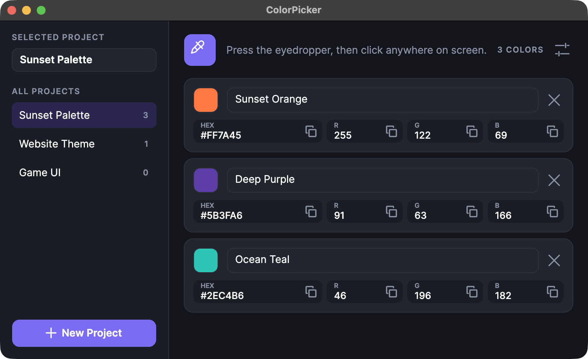

# ColorPicker for macOS

<p align="center">
  
</p>

<p align="center">
  <a href="https://github.com/ersanulker08/ColorPicker-Mac/releases/latest"><b>⬇️ Download for macOS (Apple Silicon) / macOS için indir</b></a>
</p>

A small desktop app that lets you pick colors from anywhere on your screen with an eyedropper, organize them into projects, and copy their HEX / R / G / B values with one click.

> macOS için küçük bir masaüstü uygulaması: damlalıkla ekranın herhangi bir yerinden renk seçersin, renkleri projelere ayırırsın ve HEX / R / G / B değerlerini tek tıkla kopyalarsın.

---

## Before you start

> [!IMPORTANT]
> **macOS only.** The screen-reading code uses macOS system libraries (CoreGraphics), so the app does **not** run on Windows or Linux.
>
> **.NET 10 SDK is required to run from source** (not needed if you install the `.dmg`). Install it from <https://dotnet.microsoft.com/download> and check it with `dotnet --version`.
>
> **Screen Recording permission is required.** On the first run, macOS asks for it. If every color comes out as `#000000`, open *System Settings → Privacy & Security → Screen Recording*, enable the app you started it from (for example Terminal or VS Code), then restart that app.

> **Önce bunlar / Gereklilikler**
>
> - **Sadece macOS.** Ekran okuma kodu macOS sistem kütüphanelerini (CoreGraphics) kullanıyor, bu yüzden uygulama Windows ya da Linux'ta **çalışmaz**.
> - **.NET 10 SDK, kaynak koddan çalıştırmak için gerekli** (`.dmg` ile kurarsan gerekmez). <https://dotnet.microsoft.com/download> adresinden kur, `dotnet --version` ile kontrol et.
> - **Ekran Kaydı izni gerekli.** İlk çalıştırmada macOS izin ister. Bütün renkler `#000000` çıkıyorsa *Sistem Ayarları → Gizlilik ve Güvenlik → Ekran Kaydı* bölümünden uygulamayı başlattığın programı (örneğin Terminal ya da VS Code) aç ve o programı yeniden başlat.

### Where your data is saved

> [!NOTE]
> The app does not show this anywhere in its interface, so here it is. Everything is saved automatically, every time you change something:
>
> ```
> ~/Library/Application Support/ColorPicker/
> ├── projects.json   ← your projects and their colors
> └── settings.json   ← language and "always on top" (created after you change a setting)
> ```
>
> The files are saved in the folder of the user who runs the app, **not** inside the project folder. That is why deleting `bin`/`obj`, or cloning this repo on another computer, does not carry your projects over. To move your projects, copy `projects.json` by hand. To open the folder:
>
> ```bash
> open ~/Library/Application\ Support/ColorPicker
> ```

> **Verilerin nereye kaydediliyor**
>
> Uygulamanın arayüzünde bu belirtilmiyor, o yüzden buraya yazıyorum. Bir şeyi her değiştirdiğinde otomatik kaydedilir:
>
> ```
> ~/Library/Application Support/ColorPicker/
> ├── projects.json   ← projelerin ve içindeki renkler
> └── settings.json   ← dil ve "her zaman üstte" (bir ayarı değiştirince oluşur)
> ```
>
> Dosyalar projenin klasörüne değil, uygulamayı çalıştıran kullanıcının klasörüne yazılır. Bu yüzden `bin`/`obj` klasörlerini silmek ya da repoyu başka bir bilgisayara indirmek projelerini taşımaz. Taşımak için `projects.json` dosyasını elle kopyala. Klasörü açmak için yukarıdaki `open` komutunu kullanabilirsin.

---

## Install as an app (no .NET needed)

Download `ColorPicker-x.y.z.dmg` from the [Releases](https://github.com/ersanulker08/ColorPicker-Mac/releases) page, open it, and drag **ColorPicker** into **Applications**. It is built for Apple Silicon (M1 and newer) Macs.

> [!WARNING]
> The app is not signed with a paid Apple Developer ID, so macOS says it "could not verify it is free of malware" and will not open it at first. This is expected for free, hobby apps. To open it anyway:
>
> 1. Drag **ColorPicker** into **Applications** and try to open it once (macOS will refuse).
> 2. Open *System Settings → Privacy & Security*, scroll down to the **Security** section and click **Open Anyway** next to "ColorPicker was blocked". Confirm with your password or Touch ID.
>
> (On older macOS versions, right-click the app → **Open** → **Open** also works.) Or, if you prefer the terminal, remove the quarantine flag once:
>
> ```bash
> xattr -dr com.apple.quarantine /Applications/ColorPicker.app
> ```
>
> Then give **ColorPicker** itself the Screen Recording permission (*System Settings → Privacy & Security → Screen Recording*) and restart it.

> **Uygulama olarak kurulum (.NET gerekmez):** [Releases](https://github.com/ersanulker08/ColorPicker-Mac/releases) sayfasından `ColorPicker-x.y.z.dmg` dosyasını indir, aç ve **ColorPicker**'ı **Applications** klasörüne sürükle. Apple Silicon (M1 ve sonrası) Mac'ler için derlenmiştir.
>
> **Uyarı:** Uygulama ücretli bir Apple Developer ID ile imzalı değil, bu yüzden macOS "kötü amaçlı yazılım içermediği doğrulanamadı" der ve ilk başta açmaz. Ücretsiz, hobi uygulamalarında bu normaldir. Yine de açmak için:
>
> 1. **ColorPicker**'ı **Applications**'a sürükle ve bir kez açmayı dene (macOS reddedecek).
> 2. *Sistem Ayarları → Gizlilik ve Güvenlik* sayfasını aç, aşağıdaki **Güvenlik** bölümünde "ColorPicker engellendi" yazısının yanındaki **Yine de Aç** düğmesine bas. Parolanla ya da Touch ID ile onayla.
>
> (Eski macOS sürümlerinde uygulamaya sağ tıkla → **Aç** → **Aç** de işe yarar.) Terminali tercih edersen karantina işaretini bir kez kaldırabilirsin (yukarıdaki `xattr` komutu). Sonra Ekran Kaydı iznini artık **ColorPicker**'ın kendisine ver (*Sistem Ayarları → Gizlilik ve Güvenlik → Ekran Kaydı*) ve uygulamayı yeniden başlat.

## How to run from source

```bash
git clone https://github.com/ersanulker08/ColorPicker-Mac.git
cd ColorPicker-Mac
dotnet run
```

To build the `.app` and `.dmg` yourself (they appear in `dist/`):

```bash
./tools/build-app.sh 1.0.0
```

> **Kaynak koddan çalıştırma:** Yukarıdaki üç komut: repoyu indir, klasöre gir, `dotnet run` yaz. Kendi `.app` ve `.dmg` dosyanı üretmek için `./tools/build-app.sh 1.0.0` komutunu çalıştır, sonuç `dist/` klasörüne çıkar.

## Features

- Eyedropper: press it once, click anywhere on screen, and one color is added. `Esc` cancels.
- Projects: create as many as you like, rename them from the top-left box, delete them with a right click (asks for confirmation).
- Every color gets an automatic name (`Color1`, `Color2`, …) that you can edit, plus separate HEX, R, G and B values, each with its own copy button.
- Everything saves automatically.
- Settings: *Always on top* (on by default) and language, English or Türkçe (English by default). Both are remembered.

> **Özellikler:** Damlalık (bir kez bas, ekranda bir yere tıkla, bir renk eklenir; `Esc` vazgeçirir). Sınırsız proje: sol üstteki kutudan yeniden adlandır, sağ tıkla sil (onay sorar). Her renge otomatik isim verilir (`Color1`, `Color2`, …), istersen değiştirirsin; HEX, R, G ve B ayrı gösterilir ve her birinin kopyala düğmesi vardır. Her şey otomatik kaydedilir. Ayarlar: *Her zaman üstte* (varsayılan açık) ve dil, English ya da Türkçe (varsayılan English). İkisi de hatırlanır.

---

## About this project

> [!TIP]
> **How it started.** This began as a small console program written by the author in C#. It reads the color of the pixel under the mouse cursor using macOS system calls and saves the HEX codes to a text file. That original version is still in the [`old-Consol`](old-Consol) folder, and it still works on its own.
>
> **How it grew.** The author then wanted a real interface. From that point the project was built together with **Claude**, an AI assistant made by Anthropic, using Claude Code. The author first wrote the data classes (`ColorEntry`, `Project`) and the saving code (`ProjectStore`) by hand, following step-by-step explanations. After that, Claude wrote most of the interface code: the window layout and styling, the eyedropper behavior, delete and copy actions, the settings window, and the English/Turkish translation system. The ideas, the design decisions and the testing came from the author.
>
> In short: the idea and the core color-reading code are the author's; the interface was developed together with an AI.

> **Nasıl başladı.** Bu proje, yazarın C# ile yazdığı küçük bir konsol programıyla başladı. Program, macOS sistem çağrılarıyla fare imlecinin altındaki pikselin rengini okuyup HEX kodlarını bir metin dosyasına kaydediyordu. O ilk sürüm hâlâ [`old-Consol`](old-Consol) klasöründe duruyor ve tek başına çalışıyor.
>
> **Nasıl büyüdü.** Sonra yazar gerçek bir arayüz istedi. O noktadan itibaren proje, Anthropic'in yapay zekâ asistanı **Claude** ile, Claude Code kullanılarak birlikte geliştirildi. Yazar önce veri sınıflarını (`ColorEntry`, `Project`) ve kayıt kodunu (`ProjectStore`) adım adım anlatımları izleyerek kendi eliyle yazdı. Sonrasında arayüz kodunun büyük kısmını Claude yazdı: pencere düzeni ve görünüm, damlalık davranışı, silme ve kopyalama, ayarlar penceresi ve İngilizce/Türkçe çeviri sistemi. Fikirler, tasarım kararları ve denemeler yazardan geldi.
>
> Kısaca: fikir ve renk okuyan çekirdek kod yazarın; arayüz ise yapay zekâyla birlikte geliştirildi.

### Project layout

| File | What it does |
|---|---|
| `Native.cs` | macOS calls (CoreGraphics) that read a screen pixel and the mouse state |
| `MainWindow.axaml` / `.axaml.cs` | The main window: layout and logic |
| `SettingsWindow.axaml` / `.axaml.cs` | Settings window |
| `ColorEntry.cs`, `Project.cs` | Data model: a color, and a project that holds colors |
| `ProjectStore.cs` | Loads and saves `projects.json` |
| `AppSettings.cs` | Loads and saves `settings.json` |
| `Loc.cs`, `TExtension.cs` | English/Turkish translations |
| `ConfirmWindow.cs` | The "are you sure?" dialog |
| `App.axaml` | Colors, icons and styles (the whole look is defined here) |
| `old-Consol/` | The original console version |

> **Dosya yapısı:** `Native.cs` ekran pikselini ve fare durumunu okuyan macOS çağrıları; `MainWindow.*` ana pencere; `SettingsWindow.*` ayarlar; `ColorEntry.cs` ve `Project.cs` veri modeli; `ProjectStore.cs` ve `AppSettings.cs` kayıt işleri; `Loc.cs` ve `TExtension.cs` çeviriler; `ConfirmWindow.cs` silme onay penceresi; `App.axaml` renkler, ikonlar ve stiller; `old-Consol/` ilk konsol sürümü.

## Built with

- [.NET 10](https://dotnet.microsoft.com/) and C#
- [Avalonia UI](https://avaloniaui.net/) 12 for the interface
- macOS CoreGraphics through P/Invoke for reading screen colors

> **Kullanılanlar:** .NET 10 ve C#, arayüz için Avalonia UI 12, ekran renklerini okumak için P/Invoke ile macOS CoreGraphics.

## Known limitations

- The eyedropper cursor only changes while it is over the app's own window; over other apps macOS shows its normal arrow.
- The click used to pick a color is also received by whatever is under the cursor.

> **Bilinen sınırlar:** Damlalık imleci sadece uygulamanın kendi penceresinin üstünde görünür, diğer uygulamaların üstünde macOS normal oku gösterir. Renk seçmek için yaptığın tıklama, imlecin altındaki uygulamaya da ulaşır.
